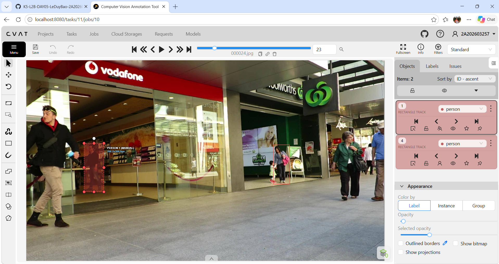
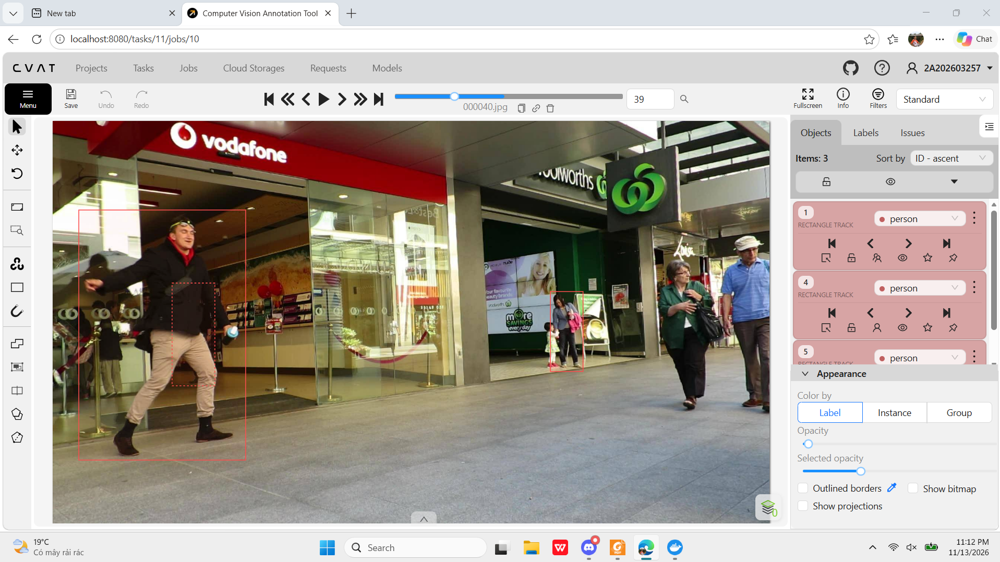
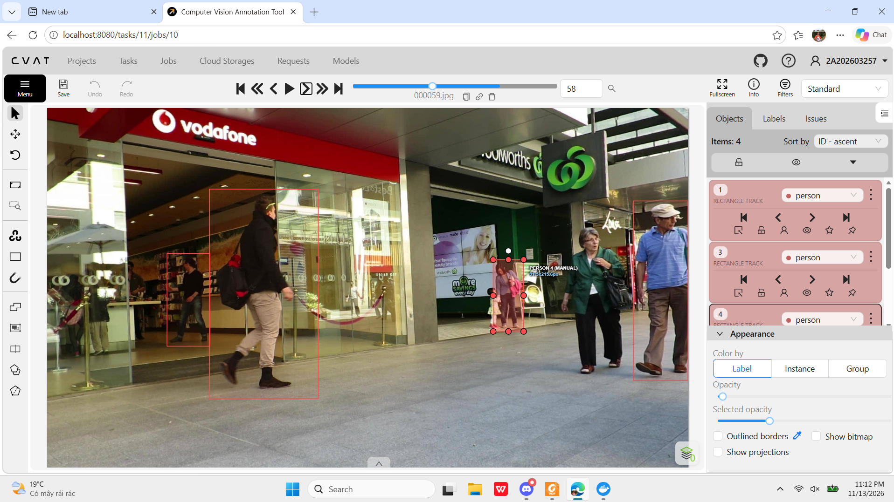

# Báo cáo cá nhân — Le Duy Bao — 2A202603257

## 0. Thông tin học viên

- Họ tên: Lê Duy Bảo
- MSSV: 2A202603257
- Mã đề: C
- Email: 26ai.baold2@vinuni.edu.vn
- Link repository: https://github.com/baodu1204/K5-L2B-DAY05-LeDuyBao-2A202603257-MOTTracking
- Giờ bắt đầu: 16h30
- Giờ kết thúc: 19h

## 1. Xem trước đoạn video (CP0)

| Mã | Frame xuất hiện | Frame cuối thấy được | Rẽ / dừng / đổi tốc độ ở frame | Bị che ở frame | Ghi chú |
|---|---:|---:|---|---|---|
| P1 | 0 | 149 | Chưa ghi nhận | Cờ `occluded` ở 10–54 trong file xuất | Mã mục tiêu MOT 1; cần bổ sung quan sát CP0 nếu còn nhớ |
| P2 | 61 | 149 | Chưa ghi nhận | Cờ `occluded` ở 61–89 trong file xuất | Mã mục tiêu MOT 7; cần bổ sung quan sát CP0 nếu còn nhớ |
| P3 | 40 | 149 | Chưa ghi nhận | Không có frame `occluded` trong file xuất | Mã mục tiêu MOT 20; cần bổ sung quan sát CP0 nếu còn nhớ |
| P4 | 2 | 149 | Chưa ghi nhận | Cờ `occluded` ở 89–149 trong file xuất | Mã mục tiêu MOT 22; cần bổ sung quan sát CP0 nếu còn nhớ |
| P5 | 28 | 149 | Chưa ghi nhận | Cờ `occluded` ở 109–149 trong file xuất | Mã mục tiêu MOT 23; cần bổ sung quan sát CP0 nếu còn nhớ |

## 2. Keyframe và thời gian (CP1, CP4)

| Mã | Số keyframe | Keyframe ở frame | Số frame có mặt | Keyframe / 100 frame | Thời gian (phút) | Chỗ khó |
|---|---:|---|---:|---:|---|---|
| P1 | 17 | 0, 10, 20, 30, 40, 50, 55, 60, 70, 80, 90, 100, 110, 120, 130, 140, 149 | 150 | 11.3 | Chưa ghi nhận | File có cờ `occluded` ở 10–54; cần xác nhận vị trí khó khi gán |
| P2 | 10 | 61, 70, 80, 90, 100, 110, 120, 130, 140, 149 | 89 | 11.2 | Chưa ghi nhận | Bắt đầu ở frame 61; file có cờ `occluded` ở 61–89 |
| P3 | 12 | 40, 50, 60, 70, 80, 90, 100, 110, 120, 130, 140, 149 | 110 | 10.9 | Chưa ghi nhận | Không có cờ `occluded` trong file xuất; cần xác nhận chỗ khó khi gán |
| P4 | 13 | 2, 10, 20, 30, 40, 50, 60, 70, 80, 89, 100, 135, 149 | 148 | 8.8 | Chưa ghi nhận | File có cờ `occluded` ở 89–149; cần xác nhận vị trí khó khi gán |
| P5 | 15 | 28, 30, 32, 37, 40, 50, 60, 70, 80, 89, 90, 100, 109, 130, 149 | 122 | 12.3 | Chưa ghi nhận | File có cờ `occluded` ở 109–149; cần xác nhận vị trí khó khi gán |
| **Tổng** | **67** | — | **619** | **10.8** | Chưa ghi nhận | — |

Keyframe / 100 frame của cả bài = 67 ÷ 619 × 100 = **10.8**.

Theo số liệu, P1 có nhiều keyframe nhất (17). Lý do cá nhân vì sao đặt các keyframe đó: do P1 xuất hiện tất cả các frame, có cờ `occluded` nên cần xác nhận vị trí khó khi gán.

## 3. Đoạn bị che (CP2)

Người được chọn: `P1` (CVAT track ID `0`, ứng với mục tiêu MOT ID `1`).

| Mốc | Frame |
|---|---:|
| Bắt đầu bị che một phần (bật `occluded`) | 10 |
| Mất hẳn (bật `outside`) | Không có frame `outside` trong file xuất |
| Hiện lại (tắt `outside`) | Không có lần bật/tắt `outside` trong file xuất |
| Thấy rõ trở lại (tắt `occluded`) | 55 |

- Thời gian khuất hẳn: **0 frame theo nhãn `outside` trong file xuất**; file thể hiện `occluded` liên tục ở frame 10–54 (45 frame).
- Quyết định thể hiện trong file xuất: giữ cùng ID `0` xuyên suốt frame 0–149; không có khoảng `outside`.
- Lý do theo dữ liệu: đoạn được gắn cờ `occluded` dài 45 frame, dưới ngưỡng 60 frame.

Ảnh chụp màn hình bắt buộc chưa có trong thư mục `report/individual/images/`. Ba ảnh thật sau khi chụp từ CVAT:





## 4. Tự review ID (CP3)

Lượt 1 theo người (đi ngược từ frame 149 về 0 trên CVAT), lượt 2 theo cảnh (nhảy 10 frame). Ít nhất 3 dòng; không có lỗi thì ghi một dòng "đã kiểm hai lượt, không lỗi".

Đã kiểm hai lượt, không lỗi.

## 5. File xuất và kết quả tự kiểm (CP4)

| Kiểm tra | Kết quả |
|---|---|
| Tên file MOT 1.1 | `src/exports/LeDuyBao_mot.zip` |
| Tên file CVAT for video 1.1 | `src/exports/LeDuyBao_cvat_video.zip` |
| Số track ID khác nhau trong `gt/gt.txt` | 5 |
| Frame `outside` không có dòng trong `gt/gt.txt` | Đúng; file xuất không có khoảng `outside` |
| Job đã completed trên CVAT máy cá nhân | đã hoàn thành |

Tóm tắt `src/check_submission.py` chạy trên hai file xuất hiện có:

```text
Số frame in theo CVAT (bắt đầu từ 0). Trong gt.txt, frame_id = frame CVAT + 1.

=== File MOT 1.1: LeDuyBao_mot.zip ===
  Số track ID: 5   |   Tổng số box: 619
  [OK]        Đúng 5 track ID.

  Track | Frame có mặt | Số frame | Đoạn vắng (outside)
      1 |   0–149      |      150 | -
      2 |   2–149      |      148 | -
      3 |  28–149      |      122 | -
      4 |  40–149      |      110 | -
      5 |  61–149      |       89 | -

=== File CVAT for video 1.1: LeDuyBao_cvat_video.zip ===
  Track | Nhãn   | Frame thấy | Keyframe | KF/100 frame | Frame occluded | Lần bật outside
      0 | person |        150 |       17 |         11.3 |             45 |               0
      1 | person |         89 |       10 |         11.2 |             29 |               0
      2 | person |        110 |       12 |         10.9 |              0 |               0
      3 | person |        148 |       13 |          8.8 |             61 |               0
      4 | person |        122 |       15 |         12.3 |             41 |               0

  Tổng: 67 keyframe / 619 frame có mặt = 10.8 keyframe / 100 frame
  [OK]        Đọc được 5 track từ annotations.xml.

=== Tóm tắt ===
  Lỗi: 0   |   Cảnh báo: 0
  Đạt. Dán phần tóm tắt này vào báo cáo mục 5.
```

## 6. Ba câu kết

1. Nếu được gán lại, bạn sẽ đặt keyframe khác ở đâu? Vì sao?

   Nếu được gán lại, tôi sẽ đặt keyframe ngay trước và sau các đoạn đối tượng đổi hướng đột ngột, bị che khuất hoặc thay đổi kích thước rõ rệt. Ở những thời điểm đó, việc theo dõi dễ mất dấu hoặc nhầm đối tượng; thêm keyframe sẽ giúp giữ quỹ đạo chính xác hơn. Với chuyển động đều, tôi sẽ dùng ít keyframe hơn để tránh thao tác thừa.

2. Có chỗ nào bạn không chắc "cùng ID hay ID mới"? Bạn đã quyết định và ghi chú thế nào?

   Có, tôi phân vân ở những khung hình đối tượng bị che khuất hoặc đi sát/cắt ngang đối tượng khác. Tôi giữ cùng ID khi đối tượng xuất hiện trở lại và vị trí, hướng di chuyển, ngoại hình còn khớp với track trước đó; tôi chỉ gán ID mới khi có căn cứ đó là một đối tượng khác. Tôi ghi chú khung hình và lý do còn phân vân, rồi kiểm tra các khung hình ngay trước và sau để xác nhận quyết định.

3. Một lỗi ID trong job của bạn (nếu không còn sót, chọn lỗi đã sửa) có thể làm xe tự lái dự đoán sai chuyển động của người đó như thế nào? Lỗi đó ảnh hưởng MOTA hay IDF1 nhiều hơn?

   Ví dụ, nếu người đi bộ bị che khuất rồi được gán ID mới dù vẫn là người cũ, xe tự lái có thể xem đó là một đối tượng vừa xuất hiện thay vì nối tiếp quỹ đạo trước đó. Dự đoán vị trí và hướng đi của người đó khi ấy có thể bị gián đoạn hoặc sai lệch. Lỗi này ảnh hưởng IDF1 nhiều hơn, vì IDF1 đánh giá việc ghép đúng danh tính qua các khung hình; MOTA cũng giảm do tính lỗi đổi ID, nhưng còn phụ thuộc cả lỗi phát hiện thừa và thiếu.

## 6. Tài liệu tham khảo và công cụ AI đã dùng

- Tài liệu dự án: `CHECKPOINTS.md`, `docs/GUIDELINE.md`, `docs/MOT_FORMAT.md`, `src/README.md`.
- Công cụ tự kiểm: `src/check_submission.py`; đã chạy trên hai file xuất hiện có.
- Copilot trong VS Code: dùng để đọc cấu trúc repo, chạy/diễn giải script tự kiểm.
